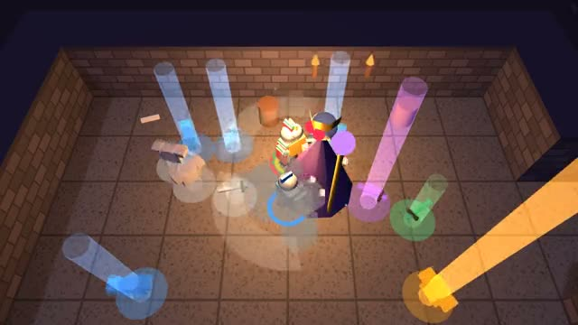

# Loot Run

Clear the floor, grab the shiny loot, go deeper. A multiplayer starter game from [Multiplayer Agent](https://multiplayeragent.com): 3D, co-op, 1–4 players, with AI heroes that fill empty seats.

## How it plays

Fight through every room of a dungeon floor with your party. Monsters drop gear in five rarities, kills level the whole party up, and when the floor is clear the stairs open to a harder one. If everyone goes down, the run ends.

**Controls:** WASD to move, aim with the mouse, click or Space to swing, E to spin; on touch, a thumb stick, ATTACK and SPIN.

## Make it yours in the Game Builder

Open the [Game Builder](https://multiplayeragent.com), choose **Start from a starter game** and pick Loot Run. It opens as version 1 in your studio, ready to play and publish. Then ask for changes, for example:

- Add a mage class that throws fireballs
- Add a shop between floors to spend gold
- Make the loot beams bigger and add a sound for legendaries

## Run it yourself

1. Get a free publishable key (`pk_…`) at [multiplayeragent.com](https://multiplayeragent.com).
2. In `index.html`, put it in place of `pk_REPLACE_ME` in the `MP_CONNECT` block.
3. Serve the folder (for example `npx serve`) and open it. The 3D engine loads as a module, which browsers block from a file on disk.

Without a key it still runs, offline with AI heroes.

## How it is built

- One `index.html` plus three.js in `libs/`. The comment at the top of the script maps the code and explains the multiplayer.
- **Saves:** Your deepest floor and your total runs and kills are saved for next time.
- **Leaderboard:** The deepest floor each player reached.
- **Host-run rules:** The host's browser runs the monsters, the loot drops and who picked up what; if it leaves, the next player takes over.
- **Bots:** AI heroes fill the party until enough people join.
- **Live sync:** Everyone sees the same dungeon, monsters, swings and loot as they happen.
- **Live ops:** Run a loot event (more drops) without touching the code.
- `?attract` runs it offline with AI heroes only. The preview video is recorded from it.

## License

MIT. three.js in `libs/` is MIT too (Copyright 2010-2024 three.js authors).
